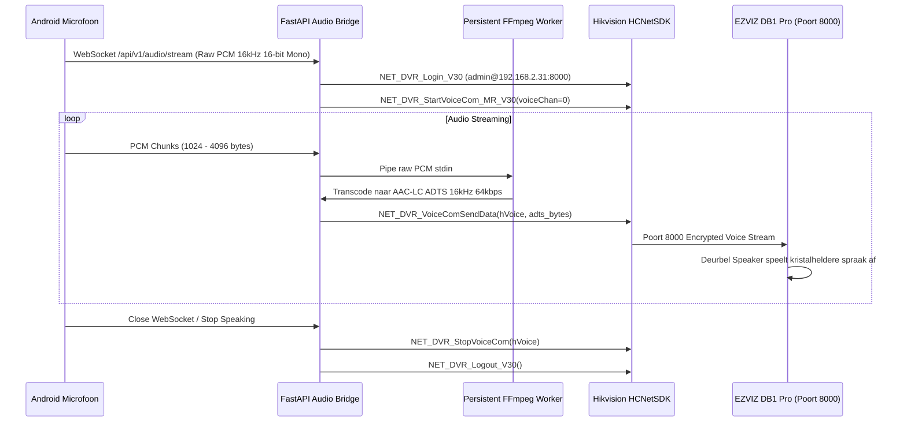

# Foxway Deurbel — Systeemarchitectuur (ARCHITECTURE.md)

Deze documentatie beschrijft de volledige systeemarchitectuur van het **Foxway Deurbel Ecosysteem**, inclusief netwerkroutering (LAN & 5G/WAN), mediaverwerking, Port 8000 Two-Way Audio bridge, het energie- en CPU-zuinige tweetraps AI-detectiepipeline, opslag- en retentiebeheer, en het beveiligingsmodel.

---

## 1. High-Level Systeemoverzicht

Het ecosysteem draait op een dedicated **HP EliteDesk 405 (AMD Ryzen 5 2400GE, 16GB RAM, SSD + NAS opslag op `/mnt/opslag`)**.

```mermaid
graph TD
    subgraph Deurbel Hardware
        CAM[EZVIZ DB1 Pro<br/>192.168.2.31]
    end

    subgraph Lokale Server [HP EliteDesk 405 - 192.168.2.1]
        G2R[go2rtc Media Engine<br/>Poort 1984 / 8554]
        FAP[FastAPI Backend Container<br/>Poort 8090 - host network]
        SQL[(SQLite Database<br/>foxway.db)]
        STO[/mnt/opslag/deurbel<br/>clips & snapshots]
        CF[Cloudflare Tunnel / Traefik<br/>deurbel.foxway.nl]
        SMTP[Stalwart / Foxway Mailserver<br/>Poort 587]
    end

    subgraph Clients
        APP_LAN[Android App (LAN)<br/>192.168.2.x]
        APP_WAN[Android App (5G / Extern)<br/>Internet]
    end

    %% Media & Control flows
    CAM -->|RTSP H.264 Main 2560x1440| G2R
    CAM -->|RTSP H.264 Sub 768x432| G2R
    FAP -->|HCNetSDK Poort 8000 AAC-LC| CAM
    G2R <-->|Internal Stream API| FAP
    FAP <--> SQL
    FAP <--> STO

    %% Reverse proxy & Routing
    CF <-->|Reverse Proxy Poort 443| FAP
    APP_LAN <-->|Direct HTTP/WS :8090| FAP
    APP_LAN -.->|Direct WebRTC :1984| G2R
    APP_WAN <-->|HTTPS / WSS Poort 443| CF
    FAP -->|SMTP 250 OK Alerts| SMTP
```

---

## 2. Dynamic LAN / WAN Routering & Stream Proxy

### 2.1 Dynamische Endpoint Resolutie in de Android App
De Android-app (`EndpointResolver.kt`) voert bij elke opstart of netwerkwijziging een snelle verbindingsprobe uit naar het LAN-adres:
- **LAN Probe:** `GET http://192.168.2.1:8090/api/v1/status` met een timeout van **1500 ms**.
- **Indien bereikbaar (binnen LAN):**
  - REST API: `http://192.168.2.1:8090`
  - WebSockets: `ws://192.168.2.1:8090/ws/...`
  - Direct go2rtc WebRTC stream: `ws://192.168.2.1:1984`
- **Indien onbereikbaar (5G, 4G, mobiele data, of extern Wi-Fi):**
  - REST API: `https://deurbel.foxway.nl`
  - WebSockets: `wss://deurbel.foxway.nl/ws/...`
  - Stream Proxy: `wss://deurbel.foxway.nl/api/ws` of `https://deurbel.foxway.nl/api/v1/stream.mp4`

### 2.2 Poort 443 Stream Proxy (Geen Geïsoleerde WAN Poorten)
Over mobiele 5G-netwerken worden willekeurige poorten (zoals UDP 8555 voor WebRTC of TCP 1984 voor go2rtc) vaak geblokkeerd door telecomproviders. Daarom proxiet de FastAPI-backend alle mediastreams via standaard HTTPS/WSS (poort 443):
1. **Low-Latency Fragmented MP4 (`fMP4`):**
   - Endpoint: `GET /api/v1/stream.mp4?src={deurbel|deurbel_sub}`
   - Streamt real-time fMP4 inclusief H.264 video en AAC-audio direct van go2rtc met zero overhead (`StreamingResponse` met chunking van 64KB).
2. **Instant Frame Fallback:**
   - Endpoint: `GET /api/v1/frame.jpeg?src={src}`
   - Haalt op ieder moment een lossless JPEG keyframe op voor snelle preview zonder opwarmtijd van videodecoder.
3. **Bi-Directionele WebRTC Signaling Proxy:**
   - Endpoints: `@app.websocket("/api/ws")` en `@app.websocket("/api/v1/webrtc/ws")`
   - Tunneling van WebRTC SDP offer/answer en MSE frames via de backend over TLS poort 443.

---

## 3. Two-Way Audio & Poort 8000 HCNetSDK AAC-LC Bridge

De EZVIZ DB1 Pro (Hikvision firmware) ondersteunt **geen** standaard RTSP backchannel (RFC 3556 / ONVIF Profile T) op poort 554; alle audio-injectiepogingen via RTSP of ISAPI `audioData` falen of worden gedropt.

### 3.1 Codec Detectie via `NET_DVR_GetCurrentAudioCompress`
Uit onze reverse-engineering van het Hikvision C-SDK protocol (`libhcnetsdk.so`) bleek:
- **Audio Enc Type:** `7` = **AAC-LC** (Advanced Audio Coding Low-Complexity)
- **Sampling Rate:** `1` = **16.000 Hz (16 kHz)**
- **Audio Channel:** Voice channel `0`
- **Formaat:** ADTS (Audio Data Transport Stream) frames met 7-byte headers.



---

## 4. Ultra-Low CPU Tweetraps AI-Detectie & Activity Zones

Om 24/7 de CPU-belasting op de Ryzen 5 2400GE onder de 2% te houden, maakt Foxway Deurbel gebruik van een **tweetraps detectiepipeline**:

```mermaid
flowchart TD
    SUB[Substream RTSP 768x432 @ 1-2 FPS] --> MASK{Activity Zone Mask}
    MASK -->|Buiten zone bijv. straat| IGNORE[Negeren / 0% CPU]
    MASK -->|Binnen zone bijv. voortuin| DIFF[Stage 1: OpenCV Frame Differencing]
    
    DIFF -->|Geen verandering| IDLE[Wacht op volgende frame]
    DIFF -->|Motion > Drempelwaarde| STAGE2[Stage 2: YOLOv8n ONNX Inference]
    
    STAGE2 --> CLASS{Classificatie}
    CLASS -->|0: person| PERSON[Mensen]
    CLASS -->|1-3, 5, 7: vehicle| VEHICLE[Voertuigen]
    CLASS -->|14-23: animal| ANIMAL[Dieren]
    CLASS -->|Geen specifieke klasse| MOTION[Overige Beweging]

    PERSON --> FILTER{Gebruikersinstelling Actief?}
    VEHICLE --> FILTER
    ANIMAL --> FILTER
    MOTION --> FILTER

    FILTER -->|Ja| REC[Start Opname + Pre-Roll Buffer]
    FILTER -->|Nee| DROP[Niet opslaan / Geen notificatie]
    
    REC --> NOTIF{Stille Uren Actief?}
    NOTIF -->|Nee| FCM[Stuur Pushnotificatie + Snapshot]
    NOTIF -->|Ja (bijv. 23:00 - 07:00)| QUIET[Opname stil opslaan]
```

- **Stage 1 (OpenCV Frame Differencing):** Analyseert een lage resolutie frame (768x432) met Gaussian blur en absolute difference. Verbruikt **< 0,8% CPU**.
- **Activity Zone / Privacy Mask:** Bovenste gedeelte van het beeld (bijv. openbare weg of bomen in de wind) kan via `ignore_top_percent` (standaard 30%) softwarematig worden gemaskeerd.
- **Stage 2 (YOLOv8n ONNX via CPUExecutionProvider):** Wordt enkel aangeroepen op de 1 of 2 keyframes waarin beweging is geconstateerd. Inference duurt slechts ~**35-45 ms** per beeld en classificeert direct in:
  1. `person`
  2. `vehicle` (auto, bus, vrachtwagen, motor, fiets)
  3. `animal` (kat, hond, vogel, etc.)
  4. `motion` (algemene beweging)

---

## 5. Videocompressie, Retentiebeheer & Star/Lock Bescherming

### 5.1 Automatische Background Compressie
Zodra een opname (automatisch via AI of handmatig via de live view) stopt, wordt een asynchrone low-priority background taak gestart:
```bash
nice -n 19 ffmpeg -y -i raw_clip.mp4 \
    -vcodec libx264 -crf 28 -preset veryfast \
    -acodec aac -b:a 48k -movflags +faststart \
    compressed_clip.mp4
```
- **Resultaat:** Bestandsgrootte gereduceerd van ~15-25 MB naar **1,5 - 3,5 MB per clip** met behoud van uitstekende beeldkwaliteit en snelle start op mobiele netwerken.
- **Thumbnail:** Directe extractie van een geoptimaliseerde JPEG op de 2e seconde (`-ss 00:00:02 -vframes 1 -q:v 3`).

### 5.2 Tweetraps Opslagopruiming & Lock/Star (⭐) Bescherming
- **Instelbare Bewaarduur (Retention Days):** Configureerbaar in de app (`GET / PUT /api/v1/settings/storage`) tussen 3 en 90 dagen.
- **Maximale Opslagcapaciteit:** Noodlimiet (standaard 10 GB). Indien de map `/mnt/opslag/deurbel/clips` deze grens overschrijdt, worden automatisch de oudste ontgrendelde clips gewist totdat er weer voldoende ruimte is.
- **Belangrijke Clips Vastzetten (⭐):** Gebruikers kunnen via het ster-icoon clips markeren als `is_locked = 1`. Vergrendelde clips worden **nooit** gewist door de automatische retentie- of capaciteit-opruimer.

---

## 6. Beveiligings- & Autorisatiemodel

1. **1-Click Pairing Protocol:**
   - Apparaat koppelt eenmalig op het lokale netwerk via `POST /api/v1/pair`.
   - Backend genereert een cryptografisch JWT-token voorzien van apparaat-ID en gebruikersnaam.
2. **WAN Authenticatie via Bearer Token:**
   - Externe verzoeken via `https://deurbel.foxway.nl` vereisen de `Authorization: Bearer <token>` header of token parameter bij WebSockets.
   - Lokale netwerkverzoeken (`192.168.2.0/24` of `127.0.0.1`) worden automatisch toegestaan voor betrouwbare lokale synchronisatie en diagnostiek.
3. **Deurbel Hardware Offline Monitor:**
   - De backend controleert elke 30 seconden de TCP bereikbaarheid van de camera (poort 8000 en 554).
   - Indien de camera langer dan 120 seconden offline is, wordt een status-update `DOORBELL_STATUS` naar alle verbonden apps gestuurd.
