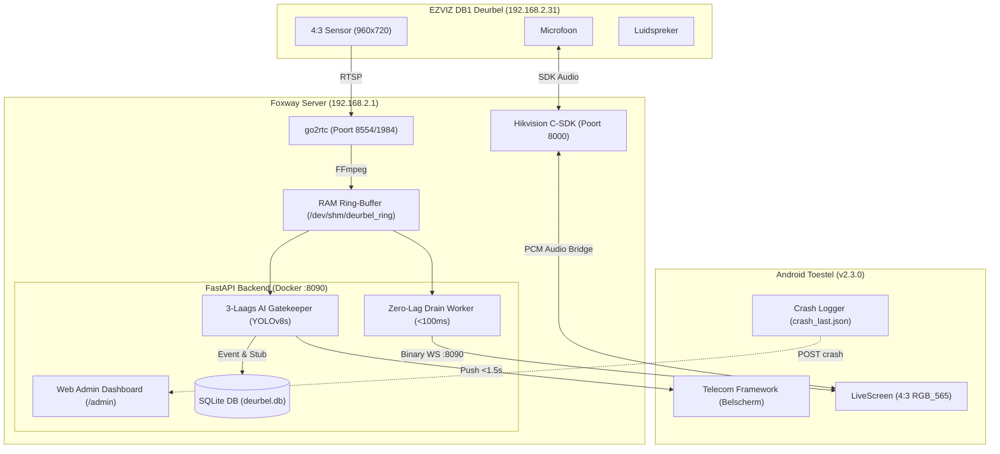
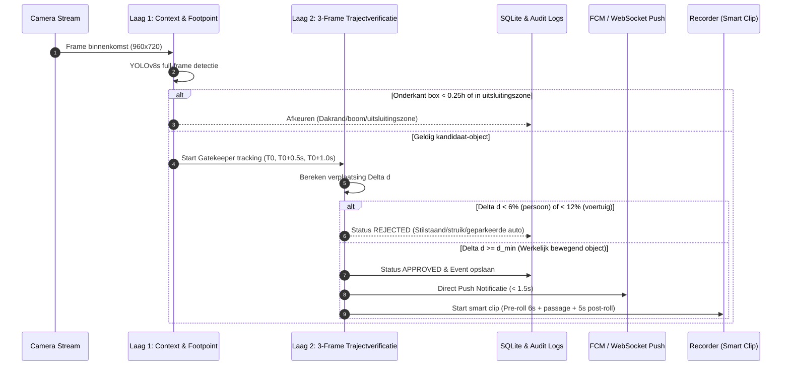

# Foxway Smart Doorbell Architectuur (v2.3.0)

Dit document beschrijft de technische opzet en datastromen van versie 2.3.0.

---

## 1. Systeemoverzicht

---

## 2. Het 3-Laags AI Verificatie Traject

---

## 3. Zero-Lag Live Stream Drain Architectuur

In traditionele pipelines buffert een OS pipe frames wanneer een client langzamer leest, waardoor de weergave 5 tot 15 seconden achterloopt op de realiteit. 

In v2.3.0 is een dedicated `_drain_worker` geïmplementeerd in `live_hub.py`:
1. Leest continu met `os.read(pipe_fd, 65536)` blokken uit de OS pipe.
2. Parsed markers (`SOI` `0xFFD8` tot `EOI` `0xFFD9`) en assembleert direct een volwaardig JPEG-frame.
3. Overschrijft onmiddellijk `_latest_jpeg_frame` in geheugen en gooit eventuele tussenliggende frames direct weg (`drop`).
4. Clients die verbonden zijn via `GET /api/v1/ws/live` ontvangen altijd het actuele beeld met een leeftijd van $<100\text{ms}$.
