# Foxway Smart Doorbell Architectuur (v3.3.1)

Dit document beschrijft de technische opzet en datastromen van versie 3.3.1.

> **HARDWARE SPECIFICATIE:** De EZVIZ DB1 Pro (`192.168.2.31`) heeft **GEEN** Poort 80 (HTTP / ISAPI / ONVIF). Er wordt NOOIT naar Poort 80 verbonden. Alle camera-interacties verlopen strikt via Poort 554 (RTSP) en Poort 8000 (Hikvision C-SDK `libhcnetsdk.so`).

---

## 1. Systeemoverzicht

```mermaid
flowchart TD
    subgraph Camera ["EZVIZ DB1 Pro Deurbel (192.168.2.31)"]
        CamSensor["4:3 Sensor (960x720 / 768x576)"]
        CamMic["Microfoon"]
        CamSpk["Luidspreker"]
        CamBtn["Hardware Drukknop"]
    end

    subgraph Server ["Foxway Server (192.168.2.1)"]
        RTSP["go2rtc (Poort 8554/1984)"]
        SDK["Hikvision C-SDK (Poort 8000 Dual Ingest)"]
        Shazam["3-Layer Shazam Chime Detector (728Hz / 570Hz, NCC >= 0.72)"]
        RingBuffer["RAM Ring-Buffer (/dev/shm/deurbel_ring - Unix TS seg_%s.ts)"]
        BlackBox["Centrale Black-Box Logging (/mnt/opslag/deurbel/logs/YYYY-MM-DD.jsonl)"]
        
        subgraph Backend ["FastAPI Backend (Docker :8090)"]
            Router["FastAPI Router"]
            LivePlayer["Zero-UI Live Player (<0.3s edge-sync, instant poster)"]
            StateEngine["Call State Machine & Trigger Source Tagger"]
            AI["Temporal AI Detector (YOLOv8n + Parked Car Gatekeeper)"]
            SDKListener["SDK Alarm Listener & 100% Buffer Sniffer"]
        end
    end

    subgraph Client ["Android App (v3.3.1, versionCode 29)"]
        LiveView["Live Kijken (2-State Mute Knop)"]
        CallView["Aanbelscherm (Tweeweg Audio)"]
        ClipsView["Opnames & Clips (Vaste 4:3 Containers)"]
        WSClient["WebSocket Foreground Service & Push Gatekeeper"]
        StatusReporter["Status-Dump Reporter"]
    end

    CamBtn -->|Poort 8000 C-SDK| SDKListener
    CamMic -->|RTSP Audio| Shazam
    Shazam -->|NCC >= 0.82| StateEngine
    SDKListener -->|Alarm Packet| StateEngine
    SDKListener --> BlackBox
    Shazam --> BlackBox
    Backend --> BlackBox
    StatusReporter -->|POST /api/v1/logs/client| BlackBox
```


            SDKAlarm["Port 8000 SDK Alarm Listener (0x1132 b44==1, 0x1133 b44 in 1,14, 0x4000 non-motion)"]
            WSProxy["WebSocket Proxy (/api/go2rtc/ws) & Zero-UI Player (/api/v1/live/player, no instant.jpg)"]
            TemporalAI["Temporal Pixel-Diff AI & Anti-Car Swap (parked_spots pre-filter)"]
            Lifecycle["2-Fasen Clip Lifecycle (RECORDING -> READY)"]
            QuietHours["Stille Uren Scheduler (23:30 - 07:30 Europe/Amsterdam)"]
            AdminUI["Web Admin Dashboard (/admin - 25 FPS Preview & Hardware Alarm Logs)"]
            SQLite[("SQLite DB WAL Mode (database.py)")]
        end
    end

    subgraph Client ["Android Toestel (v3.2.0 Build 27)"]
        Telecom["Telecom Framework (Instant Deduplication Reset on Hangup)"]
        LiveView["LiveScreen / CallScreen (Strict 4:3, Pinch-Zoom-Pan, Lifecycle Hard-Kill Audio/Stream)"]
        ClipPlayer["ClipsScreen (Strict 4:3, Pinch-Zoom-Pan, Clean ExoPlayer Dismiss)"]
        ConnMgr["ConnectionManager (Cellular-Only WAN Lock, 0ms Ping-Pong)"]
        NotifService["WebSocketForegroundService (LargeIcon + BigPicture Notification)"]
        SettingsUI["SettingsScreen (Dynamic Quiet Hours, Unlimited Test Trigger)"]
    end

    CamSensor -->|RTSP Poort 554| RTSP
    CamBtn -->|SDK Alarm Poort 8000| SDKAlarm
    SDKAlarm -->|Direct Ring Event| Telecom
    RTSP -->|FFmpeg| RingBuffer
    RTSP <-->|WebSocket Stream| WSProxy
    WSProxy -->|Native 25 FPS MSE/WebRTC| LiveView
    WSProxy -->|Embedded Zero-UI Player| AdminUI
    RTSP -.->|Instant Substream Frames| TemporalAI
    
    CamMic <-->|SDK Audio| SDK
    SDK <-->|PCM Audio Bridge| LiveView
    
    RingBuffer -->|20s Pre-roll & Gap Check| Lifecycle
    TemporalAI -->|1. Sync Snapshot >5KB| Lifecycle
    QuietHours -.->|Mute Push Notifications| NotifService
    Lifecycle -->|2. Status RECORDING| SQLite
    Lifecycle -->|3. Push <1.5s + Thumbnail| NotifService
    NotifService -->|Deeplink met Clip-ID| ClipPlayer
    ClipPlayer -->|Poll 2.0s GET /clips/id| Lifecycle
    Lifecycle -->|4. Status READY na 20s Post-Roll| SQLite
    ClipPlayer -->|Auto-Start ExoPlayer| WSProxy
    ConnMgr -->|Lock WAN on 5G| LiveView
```
    
    CrashHandler -.->|POST crash| AdminUI
```

---

## 2. Gecentraliseerde Database Concurrency (`database.py`)

In eerdere versies leidde gelijktijdig schrijven vanuit meerdere asyncio achtergrondtaken tot `OperationalError: database is locked`.

In v2.4.0 implementeert `database.py`:
1. **WAL-modus (Write-Ahead Logging):** `PRAGMA journal_mode=WAL;` en `PRAGMA synchronous=NORMAL;`.
2. **Busy Timeout van 60s:** `PRAGMA busy_timeout=60000;` en `sqlite3.connect(..., timeout=60.0)`.
3. **Write Serialization Lock:** Async schrijftransacties worden geserialiseerd via een asyncio-lock gekoppeld aan de actieve loop, ondersteund door een threading `RLock`.

---

## 3. RAM Sourcing voor Live View & AI

In eerdere versies probeerde `ai_detector.py` een afzonderlijke OpenCV RTSP-verbinding te openen, wat botste met FFmpeg en leidde tot waarschuwingen en wegvallend beeld.

In v2.4.0:
1. `live_hub.py` draait een robuuste FFmpeg drain worker (`nice -n 15`) over TCP naar de lokale `go2rtc` stream.
2. Parsed JPEG frames worden direct opgeslagen in `live_hub.latest_jpeg`.
3. `ai_detector.py` vraagt frames direct op via `live_hub.get_latest_frame()` (0 extra RTSP sessies, 0 extra CPU).
4. De Web Admin UI gebruikt `/api/v1/live/instant.jpg` die ditzelfde RAM-frame direct serveert.

---

## 4. 20s Pre-Roll & 20s Post-Roll Opname

1. De RAM ring-buffer (`/dev/shm/deurbel_ring`) bewaart 25 segmenten van 2 seconden (50 seconden capaciteit).
2. Bij een bewegings- of belgebeurtenis berekent `recorder.py` het tijdstip $T_0$.
3. Segmenten worden strikt gefilterd met $mtime \in [T_0 - 20\text{s}, T_0]$. Dit levert exact 10 segmenten (20 seconden pre-roll) op.
4. Na beëindiging van de beweging neemt de recorder nog 20 seconden post-roll op.
5. De preview snapshot op $T_0$ wordt direct uit de actieve live RAM-buffer gecachet, waardoor zwarte videothumbnails definitief zijn verholpen.
