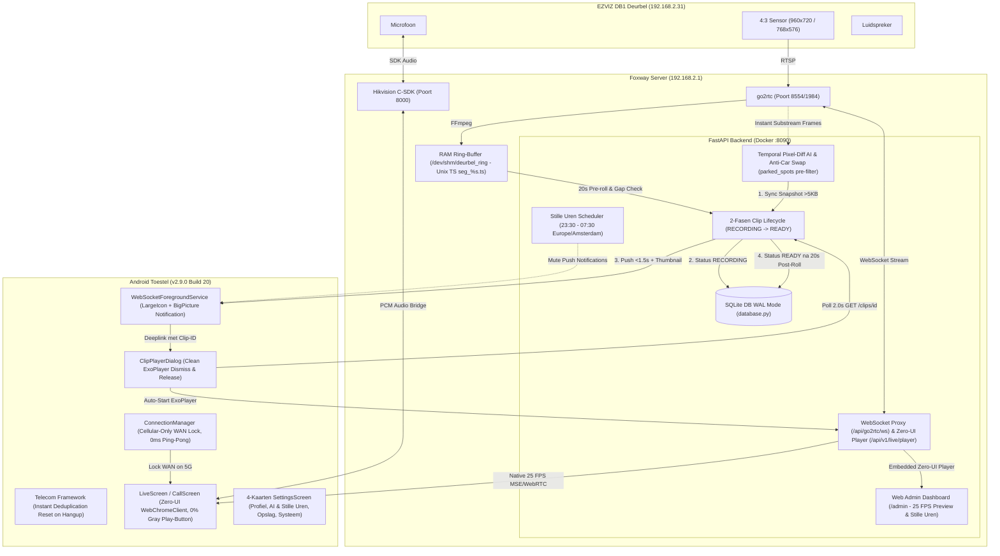

# Foxway Smart Doorbell Architectuur (v2.9.0)

Dit document beschrijft de technische opzet en datastromen van versie 2.9.0.

---

## 1. Systeemoverzicht


    
    CrashHandler -.->|POST crash| AdminUI
```

---

## 2. Gecentraliseerde Database Concurrency (`database.py`)

In eerdere versies leidde gelijktijdig schrijven vanuit meerdere asyncio achtergrondtaken tot `OperationalError: database is locked`.

In v2.4.0 implementeert `database.py`:
1. **WAL-modus (Write-Ahead Logging):** `PRAGMA journal_mode=WAL;` en `PRAGMA synchronous=NORMAL;`.
2. **Busy Timeout van 60s:** `PRAGMA busy_timeout=60000;` en `sqlite3.connect(..., timeout=60.0)`.
3. **Write Serialization Lock:** Async schrijftransacties worden geserialiseerd via een asyncio-lock gekoppeld aan de actieve loop, ondersteund door een threading `RLock`.

---

## 3. RAM Sourcing voor Live View & AI

In eerdere versies probeerde `ai_detector.py` een afzonderlijke OpenCV RTSP-verbinding te openen, wat botste met FFmpeg en leidde tot waarschuwingen en wegvallend beeld.

In v2.4.0:
1. `live_hub.py` draait een robuuste FFmpeg drain worker (`nice -n 15`) over TCP naar de lokale `go2rtc` stream.
2. Parsed JPEG frames worden direct opgeslagen in `live_hub.latest_jpeg`.
3. `ai_detector.py` vraagt frames direct op via `live_hub.get_latest_frame()` (0 extra RTSP sessies, 0 extra CPU).
4. De Web Admin UI gebruikt `/api/v1/live/instant.jpg` die ditzelfde RAM-frame direct serveert.

---

## 4. 20s Pre-Roll & 20s Post-Roll Opname

1. De RAM ring-buffer (`/dev/shm/deurbel_ring`) bewaart 25 segmenten van 2 seconden (50 seconden capaciteit).
2. Bij een bewegings- of belgebeurtenis berekent `recorder.py` het tijdstip $T_0$.
3. Segmenten worden strikt gefilterd met $mtime \in [T_0 - 20\text{s}, T_0]$. Dit levert exact 10 segmenten (20 seconden pre-roll) op.
4. Na beëindiging van de beweging neemt de recorder nog 20 seconden post-roll op.
5. De preview snapshot op $T_0$ wordt direct uit de actieve live RAM-buffer gecachet, waardoor zwarte videothumbnails definitief zijn verholpen.
